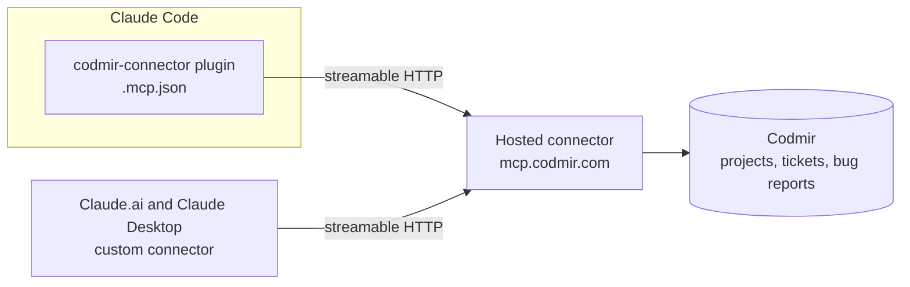
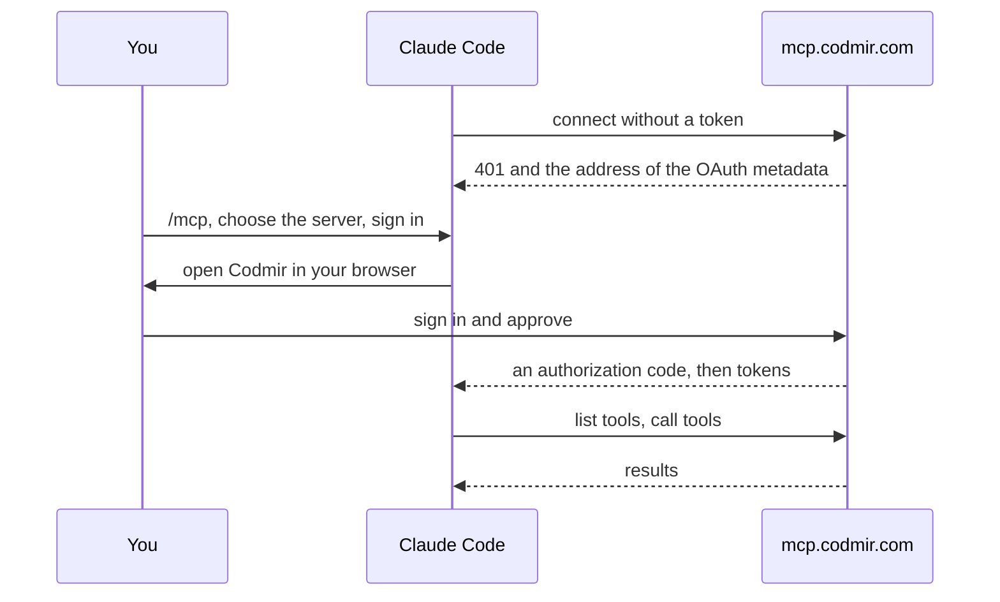

<p align="center">
  <picture>
    <source media="(prefers-color-scheme: dark)" srcset="docs/assets/hero-dark.svg">
    <source media="(prefers-color-scheme: light)" srcset="docs/assets/hero-light.svg">
    
  </picture>
</p>

<p align="center">
  <a href="#install-in-claude-code"></a>
  <a href="#how-it-works"></a>
  <a href="#tools"></a>
  <a href="LICENSE"></a>
</p>

<p align="center">
  <a href="#install-in-claude-code"></a>
  <a href="#claudeai-and-claude-desktop"></a>
  <a href="#claudeai-and-claude-desktop"></a>
  <a href="#authentication"></a>
  <a href="#this-plugin-and-codmirmcp"></a>
</p>

<p align="center">
  <a href="#install-in-claude-code"><b>Install</b></a> ·
  <a href="#claudeai-and-claude-desktop"><b>Claude.ai and Desktop</b></a> ·
  <a href="#tools"><b>Tools</b></a> ·
  <a href="#how-it-works"><b>How it works</b></a> ·
  <a href="#authentication"><b>Authentication</b></a> ·
  <a href="#troubleshooting"><b>Troubleshooting</b></a> ·
  <a href="#faq"><b>FAQ</b></a> ·
  <a href="https://codmir.com"><b>codmir.com</b></a>
</p>

Work with your [Codmir](https://codmir.com) projects, tickets and bug reports from Claude. This repository is a Claude
Code plugin. It connects Claude Code to Codmir's hosted connector, a remote
[Model Context Protocol](https://modelcontextprotocol.io) server. You sign in with OAuth in your browser, so there is no
token to paste and no server to run.

```bash
claude plugin marketplace add codmir-labs/mcp-plugin-anthropic
claude plugin install codmir-connector@codmir
```

Then start Claude Code, run `/mcp`, choose the Codmir server and sign in. [Step by step](#install-in-claude-code).

> [!NOTE]
> The plugin is for Claude Code. In Claude.ai and Claude Desktop, add the same address, `https://mcp.codmir.com/`, as a
> [custom connector](#claudeai-and-claude-desktop). For a server that runs on your own machine, use
> [`@codmir/mcp`](https://github.com/codmir-labs/mcp).

<details>
<summary><b>Contents</b></summary>

- [Status](#status)
- [What it gives Claude](#what-it-gives-claude)
- [Install in Claude Code](#install-in-claude-code)
- [Claude.ai and Claude Desktop](#claudeai-and-claude-desktop)
- [Tools](#tools): [workspace](#workspace), [tickets](#tickets), [bug reports](#bug-reports-and-feedback), [calls and background work](#calls-and-background-work)
- [How it works](#how-it-works)
- [Authentication](#authentication): [what Claude may do](#what-claude-may-do)
- [Troubleshooting](#troubleshooting)
- [FAQ](#faq)
- [This plugin and @codmir/mcp](#this-plugin-and-codmirmcp)
- [What is in this repository](#what-is-in-this-repository)
- [License](#license)
- [Links](#links)

</details>

## Status

Checked on 2026-11-24 with Claude Code 2.1.296 and 2.1.331.

| Part | Today | How it was checked |
| ---- | ----- | ------------------ |
| Plugin | A Claude Code plugin, version 1.0.0. It adds one MCP server, `codmir`. It adds no skills, agents or hooks. | `claude plugin validate --strict` passes. `claude plugin details codmir-connector` lists the one server and nothing else. |
| Server | Codmir's hosted connector at `https://mcp.codmir.com/`. There is no server code in this repository. | After an install, `claude mcp list` shows `plugin:codmir-connector:codmir` at that address. |
| Sign-in | OAuth, run by your client. This repository stores no token and asks for none. | A request without a token gets `401` and the address of the connector's OAuth metadata. |
| Tools | 16, listed under [Tools](#tools). | The connector's own tool definitions. |

## What it gives Claude

<table>
<tr>
<td width="33%" valign="top">
<br>
<b>Workspace</b><br>
See the organizations you belong to, read a project's overview, and create a project.
</td>
<td width="33%" valign="top">
<br>
<b>Tickets</b><br>
List what is open, read a ticket with its comments, search, create, update, comment and set a status.
</td>
<td width="33%" valign="top">
<br>
<b>Bug reports</b><br>
Search, file and upvote public bug reports about any vendor's product, and send feedback on a model's answer.
</td>
</tr>
<tr>
<td width="33%" valign="top">
<br>
<b>One plugin</b><br>
Two commands to install it. It holds one address and runs nothing on your machine.
</td>
<td width="33%" valign="top">
<br>
<b>OAuth sign-in</b><br>
You sign in to Codmir in your browser. No token to create, paste or keep in a file.
</td>
<td width="33%" valign="top">
<br>
<b>Hosted connector</b><br>
Claude.ai and Claude Desktop take the same address, <code>https://mcp.codmir.com/</code>, as a custom connector.
</td>
</tr>
</table>

## Install in Claude Code

**1. Add the marketplace and install the plugin.** In your shell:

```bash
claude plugin marketplace add codmir-labs/mcp-plugin-anthropic
claude plugin install codmir-connector@codmir
```

Or inside a Claude Code session:

```text
/plugin marketplace add codmir-labs/mcp-plugin-anthropic
/plugin install codmir-connector@codmir
```

**2. Load it.** Start Claude Code. In a session that is already open, run `/reload-plugins`.

**3. Sign in.** Run `/mcp`, choose the Codmir server and follow the steps in your browser.

**4. Try it.** Ask Claude: `Which Codmir organizations do I belong to?` The tool for that is `get_workspace_status`.

Check the install from your shell:

```bash
claude plugin list
claude mcp list
```

Until you sign in, `claude mcp list` shows the server like this:

```text
plugin:codmir-connector:codmir: https://mcp.codmir.com/ (HTTP) - ! Needs authentication
```

Anthropic's guides: [Install and manage plugins](https://code.claude.com/docs/en/plugins/install) and
[Connect Claude Code to tools via MCP](https://code.claude.com/docs/en/mcp).

<details>
<summary><b>One command instead of two</b></summary>

| Where | Command | Needs |
| ----- | ------- | ----- |
| In a session | `/plugin install codmir-connector --marketplace codmir-labs/mcp-plugin-anthropic` | Claude Code 2.1.275 or later |
| In your shell | `claude plugin install codmir-connector --marketplace codmir-labs/mcp-plugin-anthropic` | Claude Code 2.1.292 or later |

</details>

<details>
<summary><b>For everyone who works in a repository</b></summary>

Run both commands with `--scope project` inside the repository:

```bash
claude plugin marketplace add --scope project codmir-labs/mcp-plugin-anthropic
claude plugin install --scope project codmir-connector@codmir
```

They write this to `.claude/settings.json`, which you can commit:

```json
{
  "extraKnownMarketplaces": {
    "codmir": {
      "source": {
        "source": "github",
        "repo": "codmir-labs/mcp-plugin-anthropic"
      }
    }
  },
  "enabledPlugins": {
    "codmir-connector@codmir": true
  }
}
```

No sign-in is shared. Each person signs in to Codmir with their own account.

</details>

<details>
<summary><b>Without the plugin</b></summary>

The plugin adds one address. You can add it by hand instead:

```bash
claude mcp add --transport http codmir https://mcp.codmir.com/
```

Then run `/mcp` in a session and sign in, or run `claude mcp login codmir` in your shell.

By default the server is added for you in the current project only. Add `--scope user` for all your projects, or
`--scope project` to write it to a `.mcp.json` that your team can commit. Manage it with `claude mcp list`,
`claude mcp get codmir` and `claude mcp remove codmir`.

Use the plugin or this command, not both. With both, Claude Code lists only the server you added by hand, because the
two point at the same address.

</details>

<details>
<summary><b>Update, turn off, sign out, remove</b></summary>

| To | Run |
| -- | --- |
| Update | `claude plugin marketplace update codmir`, then `claude plugin update codmir-connector@codmir` |
| Turn off | `claude plugin disable codmir-connector@codmir` |
| Turn on again | `claude plugin enable codmir-connector@codmir` |
| Sign out | `claude mcp logout plugin:codmir-connector:codmir` |
| Remove | `claude plugin uninstall codmir-connector@codmir`, then `claude plugin marketplace remove codmir` |

Claude Code does not update plugins from this marketplace on its own. To turn that on, run `/plugin`, open the
**Marketplaces** tab and select `codmir`.

</details>

## Claude.ai and Claude Desktop

These take the connector's address as a custom connector. You do not need the plugin.

```text
https://mcp.codmir.com/
```

The steps below follow Anthropic's guide,
[Get started with custom connectors using remote MCP](https://support.claude.com/en/articles/11175166-get-started-with-custom-connectors-using-remote-mcp),
as of 2026-11-24. Menus move. If yours differ, the guide wins.

<details>
<summary><b>Claude.ai</b></summary>

1. Open **Customize > Connectors**.
2. Click **+ Add**, then **Add custom connector**.
3. Enter a name, for example `Codmir`.
4. Enter the URL `https://mcp.codmir.com/` and click **Continue**.
5. Review the authentication settings Claude detected and click **Continue**. Leave **Request headers** empty: that
   section is for fixed credentials such as API keys, and this connector signs you in with OAuth.
6. Click **Add**. Claude takes you through Codmir's sign-in. If Codmir appears in the list with a **Connect** button
   instead, click it and sign in.
7. In a conversation, open the **+** menu, choose **Connectors** and switch Codmir on.

On a Team or Enterprise plan an Owner adds the connector once, under **Organization settings > Connectors** (**Add**,
hover over **Custom**, then select **Web**). Each member then opens **Customize > Connectors** and clicks **Connect**
next to it. On Enterprise, a custom role that includes "Manage access to Libraries" can add it too. A Free plan can have
one custom connector.

Claude connects to the server from Anthropic's cloud, not from your machine, and only over HTTPS on port 443.

</details>

<details>
<summary><b>Claude Desktop</b></summary>

Anthropic's guide says that although Claude Desktop runs on your computer, remote connectors are configured and brokered
through your Claude account. So the Claude.ai steps above are also the Claude Desktop steps.

To run a local server in Claude Desktop instead, add it to `claude_desktop_config.json` and restart the app. Open the
file from **Settings > Developer > Edit Config**. It lives here
([Connect to local MCP servers](https://modelcontextprotocol.io/docs/develop/connect-local-servers)):

| System | File |
| ------ | ---- |
| macOS | `~/Library/Application Support/Claude/claude_desktop_config.json` |
| Windows | `%APPDATA%\Claude\claude_desktop_config.json` |
| Linux | `~/.config/Claude/claude_desktop_config.json` |

```json
{
  "mcpServers": {
    "codmir": {
      "command": "npx",
      "args": ["-y", "-p", "@codmir/mcp", "codmir-mcp"]
    }
  }
}
```

That is the `@codmir/mcp` server, which signs in with the Codmir CLI. See its
[authentication section](https://github.com/codmir-labs/mcp#authentication).

</details>

## Tools

The 16 tools of the hosted connector, checked on 2026-11-24 against the connector's own tool definitions. The connector
sends Claude its list each time you connect. If that list differs from this page, the connector's list wins.

**Plan** is the lowest Codmir plan the tool works on; the plans are on [codmir.com/pricing](https://codmir.com/pricing).
Six tools only read. The other ten change data or start something.

### Workspace

| Tool | What it does | Required | Plan | Changes data |
| ---- | ------------ | -------- | ---- | ------------ |
| `get_workspace_status` | Lists the organizations you belong to: id, name, slug, plan, your role and the number of projects. | none | Free | no |
| `get_project_context` | Returns one project: name, key, type, description, git remote and branch, settings and created date, plus its open, total, member and sprint counts. Open means `OPEN` or `IN_PROGRESS`. Values marked hidden in the settings are redacted. | `projectId` | Free | no |
| `create_project` | Creates a project in `organizationId`, or in one of your organizations when you leave it out. `key` defaults to the first five letters or digits of the name, and `projectType` to `software`. | `name` | Pro | yes |

### Tickets

| Tool | What it does | Required | Plan | Changes data |
| ---- | ------------ | -------- | ---- | ------------ |
| `list_todo` | Lists a project's actionable tickets: `OPEN`, `IN_PROGRESS` and `TODO`, or one `status` such as `open` or `in_progress`, and one `priority` if you give it. Archived tickets are left out. Each item has id, key, title, status, priority, type, assignee and due date. At most 100, default 50. | `projectId` | Free | no |
| `get_ticket` | Returns one ticket by id, or by key such as `PROJ-42`: its fields, project id, assignee, reporter, labels and its 10 newest comments. | `ticketId` | Free | no |
| `search_tickets` | Finds tickets in one project whose title or description contains `query`, ignoring case, with one `status` if you give it. At most 50, default 20, most recently updated first. | `projectId`, `query` | Free | no |
| `create_ticket` | Creates an `OPEN` ticket. `priority` is `LOW`, `MEDIUM` (default), `HIGH` or `CRITICAL`. `ticketType` is `TASK` (default), `BUG`, `STORY`, `EPIC`, `FEATURE`, `IMPROVEMENT` or `RESEARCH`. Without `assigneeId` it goes to the project's default assignee, or to its only member. The assignee gets a notification, unless it is you. | `projectId`, `title` | Pro | yes |
| `update_ticket` | Changes a ticket's title, description, priority, type, status, assignee (`unassign` clears it) or due date. Takes the ticket's id, as `get_ticket` returns it. | `ticketId` | Pro | yes |
| `update_todo_status` | Sets a ticket's status, for example `open`, `in_progress` or `done`. Takes the ticket's id. | `ticketId`, `status` | Pro | yes |
| `add_comment` | Adds a comment to a ticket as you. Takes the ticket's id. | `ticketId`, `content` | Pro | yes |

### Bug reports and feedback

Reports and feedback are public, so leave secrets and private code out of them.

| Tool | What it does | Required | Plan | Changes data |
| ---- | ------------ | -------- | ---- | ------------ |
| `search_bug_reports` | Finds public bug reports about one vendor, by `query` and `status` if you give them. Up to 10, most upvoted first, with the total. | `vendor` | Free | no |
| `report_bug` | Files a bug report against a vendor, with steps, expected and actual behavior, product, version and environment if you give them. The title has 5 to 200 characters. `severity` is `LOW`, `MEDIUM`, `HIGH` or `CRITICAL`. Creates the vendor's page when there is none. | `vendor`, `title`, `description`, `severity` | Free | yes |
| `upvote_bug_report` | Adds your vote to a bug report. A second vote from you changes nothing. | `report_id` | Free | yes |
| `report_feedback` | Sends feedback on a model's output: a comparison of two answers, a rating or a flag. | `vendor`, `feedback_type`, `prompt` | Free | yes |

### Calls and background work

| Tool | What it does | Required | Plan | Changes data |
| ---- | ------------ | -------- | ---- | ------------ |
| `call_number` | Starts a phone call by Codmir's phone agent to `to`, a number such as `+15551234567`, with your `objective`. Returns the call's ids. Answers with an error when the phone service is not available. | `to`, `objective` | Premium | yes, it places a call |
| `spawn_work` | Takes a `category` such as `research` or `call` and an `objective`, and returns a work id. With `call` and a phone number in the objective, it asks the phone service to place the call. No tool on this page reads the work back. | `category`, `objective` | Premium | yes, it can place a call |

<details>
<summary><b>What changed from the earlier list</b></summary>

Earlier versions of this page listed 14 tools of a server that is no longer here. Ten of them are in the hosted
connector.

| | Tools |
| --- | --- |
| Not in the connector | `create_organization`, `execute_task`, `check_task_status`, `store_conversation` |
| In the connector, not in the old list | `report_bug`, `search_bug_reports`, `upvote_bug_report`, `report_feedback`, `call_number`, `spawn_work` |

`create_ticket` and `update_ticket` now take `ticketType`, with `type` as an older name for it, and `create_ticket` also
takes `assigneeId`.

</details>

## How it works



The plugin is configuration. Claude Code reads [`.mcp.json`](.mcp.json), finds one HTTP server named `codmir` and
connects to it. The tools run at Codmir, as you. Nothing is built, and no process starts on your machine.

```json
{
  "mcpServers": {
    "codmir": {
      "type": "http",
      "url": "https://mcp.codmir.com/"
    }
  }
}
```

The first connection, and signing in:



## Authentication

Codmir's hosted connector signs you in with OAuth. Your client opens Codmir in your browser. You sign in and approve,
and the client keeps the tokens. There is no token to create or paste, and none in this repository.

The connector publishes how it signs you in. Both documents open without a login:

| Document | What it says |
| -------- | ------------ |
| [`/.well-known/oauth-protected-resource`](https://mcp.codmir.com/.well-known/oauth-protected-resource) | The resource and its authorization server are both `https://mcp.codmir.com/`. The scope is `mcp:tools`. |
| [`/.well-known/oauth-authorization-server`](https://mcp.codmir.com/.well-known/oauth-authorization-server) | The authorization code flow with PKCE (`S256`), refresh tokens and client registration. |

Without a token the connector answers `401` and points to the first one:

```bash
curl -sI https://mcp.codmir.com/
```

```text
HTTP/2 401
www-authenticate: Bearer error="invalid_token", error_description="Missing Authorization header", resource_metadata="https://mcp.codmir.com/.well-known/oauth-protected-resource"
```

(The status line and one header of the answer.)

The tools run as you. You can reach a project when you are a member of its organization.

### What Claude may do

Claude Code's permission rules apply to these tools. In a rule, a plugin's tool has a long name:
`mcp__plugin_codmir-connector_codmir__` and then the tool's name. These two rules keep Claude from placing calls:

```json
{
  "permissions": {
    "deny": [
      "mcp__plugin_codmir-connector_codmir__call_number",
      "mcp__plugin_codmir-connector_codmir__spawn_work"
    ]
  }
}
```

They go in a settings file such as `.claude/settings.json`. See
[permission rules](https://code.claude.com/docs/en/permissions). In Claude.ai, Anthropic's guide says to review tool
approval requests carefully and to click "Allow always" only for a server and tool you trust to run unsupervised.

## Troubleshooting

<details>
<summary><b>Claude shows no Codmir tools</b></summary>

Run `claude mcp list`.

| It shows | Do this |
| -------- | ------- |
| `! Needs authentication` | Run `/mcp` in a session, choose the server and sign in. |
| No Codmir server | Run `claude plugin list`. The plugin must be there and `enabled`. In an open session, run `/reload-plugins`. |

</details>

<details>
<summary><b>The tools worked, and now Claude Code asks me to sign in again</b></summary>

Open `/mcp` and select **Re-authenticate** on the server.

</details>

<details>
<summary><b><code>No MCP server named "codmir"</code></b></summary>

The plugin's server has a longer name. Use it wherever a command takes a server name:

```bash
claude mcp get plugin:codmir-connector:codmir
claude mcp logout plugin:codmir-connector:codmir
```

</details>

<details>
<summary><b>I see two Codmir servers</b></summary>

You also added one by hand. The same address counts as one server. An address that ends in `/mcp`, or the local
`@codmir/mcp` server, counts as another. Remove the one you do not want:

```bash
claude mcp remove codmir
```

</details>

<details>
<summary><b>Claude asks for a project id, or a tool answers <code>projectId is required</code></b></summary>

The connector has no tool that lists projects, so give Claude the id. Two places to get it:

- `get_ticket` returns the project id of any ticket, and it takes a key such as `PROJ-42`.
- A repository linked with the Codmir CLI has it in [`.codmir.json`](https://github.com/codmir-labs/mcp#default-project).

</details>

<details>
<summary><b>A tool answers <code>requires a PRO plan</code> or <code>requires a PREMIUM plan</code></b></summary>

The tool needs a higher Codmir plan. The **Plan** column under [Tools](#tools) names the lowest one. The plans are on
[codmir.com/pricing](https://codmir.com/pricing).

</details>

<details>
<summary><b>A tool answers <code>Daily rate limit reached</code></b></summary>

Your plan's calls for the day are used up. The count starts again at midnight UTC.

</details>

<details>
<summary><b><code>Access denied: not a member of this project's organization</code></b></summary>

You are signed in with an account that is not in the project's organization. Sign out, then sign in with the one that
is.

</details>

<details>
<summary><b><code>No organizations found</code></b></summary>

The message suggests `create_organization`, which the hosted connector does not have.
[`@codmir/mcp`](https://github.com/codmir-labs/mcp#create_organization) does.

</details>

<details>
<summary><b>Adding the marketplace fails while cloning</b></summary>

Claude Code clones this repository over SSH when your SSH key works with GitHub, and over HTTPS otherwise. To always use
HTTPS:

```bash
CLAUDE_CODE_PLUGIN_PREFER_HTTPS=1 claude plugin marketplace add codmir-labs/mcp-plugin-anthropic
```

</details>

<details>
<summary><b>Claude.ai cannot connect to the connector</b></summary>

Enter the address exactly as written, `https://mcp.codmir.com/`. Claude connects from Anthropic's cloud, so the address
must be public and on HTTPS port 443. An address with another port, or one on a private network, cannot connect.

</details>

<details>
<summary><b>I am on a Team or Enterprise plan and cannot add a custom connector</b></summary>

Only an Owner or Primary Owner can add one on a Team plan. On Enterprise a custom role with "Manage access to Libraries"
can too. Ask one of them to add it under **Organization settings > Connectors**, then click **Connect** under
**Customize > Connectors**.

</details>

<details>
<summary><b>Other instructions show <code>https://mcp.codmir.com/mcp</code></b></summary>

Both addresses answer. This plugin and Codmir's installer, [`install.sh`](https://codmir.com/install.sh), use
`https://mcp.codmir.com/`, so use that one. Claude Code treats the two as different servers.

</details>

## FAQ

<details>
<summary><b>Is this Codmir's own connector?</b></summary>

Yes. The connector is the server Codmir hosts at `https://mcp.codmir.com/`. This repository is Codmir's Claude Code
plugin for it.

</details>

<details>
<summary><b>Does anything run on my machine?</b></summary>

No. The plugin has no hooks, no commands and no local server. Claude Code connects to its one address over HTTPS.

</details>

<details>
<summary><b>What can Claude change?</b></summary>

Ten of the 16 tools write or start something: create a project, create and update a ticket, set a status, add a comment,
file a bug report, vote for one, send feedback, start a call and ask for background work. The other six only read.
[What Claude may do](#what-claude-may-do) shows how to block a tool.

</details>

<details>
<summary><b>What does the plugin add to my sessions?</b></summary>

`claude plugin details codmir-connector` reports about 0 tokens added to every session. It does not count the tools'
schemas, which Claude Code gets from the connector.

</details>

<details>
<summary><b>Where did the server code go?</b></summary>

Earlier versions of this repository held a copy of a connector server. This repository no longer ships a server. The
hosted connector is the one server, and the plugin points to it.

</details>

<details>
<summary><b>Can I use it in Cursor, VS Code or Windsurf?</b></summary>

This plugin is for Claude Code. For those editors use [`@codmir/mcp`](https://github.com/codmir-labs/mcp#clients), which
has steps for each.

</details>

<details>
<summary><b>Which Claude plans can add a custom connector?</b></summary>

Per Anthropic's guide, Free, Pro, Max, Ultra, Team and Enterprise plans. A Free plan is limited to one. On Team and
Enterprise only an Owner, or an Enterprise custom role, can add one.

</details>

<details>
<summary><b>Is it open source?</b></summary>

This repository is [Apache-2.0](LICENSE). The hosted connector runs at Codmir, and its code is not here. The local
server, [`@codmir/mcp`](https://github.com/codmir-labs/mcp), is Apache-2.0 too.

</details>

## This plugin and @codmir/mcp

| | This plugin | `@codmir/mcp` |
| --- | --- | --- |
| What it is | The address of the hosted connector | A server that your MCP client starts |
| Where the server runs | At Codmir, `https://mcp.codmir.com/` | On your machine |
| Transport | Streamable HTTP | stdio |
| Sign-in | OAuth in the browser | `codmir login`, or a token and user id in environment variables |
| Clients | Claude Code. Claude.ai and Claude Desktop take the same address as a custom connector | Claude Desktop, Claude Code, Cursor, VS Code and Windsurf |
| Tools | The 16 above | 83 on `main`, 33 in 0.2.5, the latest npm release |

The `@codmir/mcp` column follows its [README](https://github.com/codmir-labs/mcp). The 33 is the list that 0.2.5 sent when
it was started on 2026-11-24.

## What is in this repository

| Path | What it holds |
| ---- | ------------- |
| [`.mcp.json`](.mcp.json) | The one MCP server: `codmir`, type `http`, at `https://mcp.codmir.com/` |
| [`.claude-plugin/plugin.json`](.claude-plugin/plugin.json) | The plugin's manifest: name `codmir-connector`, version, author and license |
| [`.claude-plugin/marketplace.json`](.claude-plugin/marketplace.json) | The marketplace `codmir`, with this repository as its one plugin |
| [`.well-known/mcp.json`](.well-known/mcp.json) | A description of the hosted connector: address, streamable HTTP and OAuth. Claude Code does not read it |
| [`docs/assets/`](docs/assets) | This page's hero and icons |
| [`LICENSE`](LICENSE) | Apache-2.0 |

To check a copy of it:

```bash
git clone https://github.com/codmir-labs/mcp-plugin-anthropic.git
claude plugin validate --strict ./mcp-plugin-anthropic
```

Claude Code keeps an installed plugin on its version until the `version` in `plugin.json` changes, so a change to the
plugin needs a new version
([manifest reference](https://code.claude.com/docs/en/plugins/manifest-reference)).

## License

[Apache-2.0](LICENSE)

## Links

- [codmir.com](https://codmir.com): the platform
- [Documentation](https://codmir.com/docs/mcp): the Codmir docs page for the local MCP server
- [Support](https://codmir.com/support)
- [Privacy policy](https://codmir.com/privacy-policy)
- [`@codmir/mcp`](https://github.com/codmir-labs/mcp): the local stdio server
- [`@codmir/sdk`](https://github.com/codmir-labs/sdk): the SDK for application code
- [Model Context Protocol](https://modelcontextprotocol.io): the specification
- [Install and manage plugins](https://code.claude.com/docs/en/plugins/install): Anthropic's guide for Claude Code plugins
- [Connect Claude Code to tools via MCP](https://code.claude.com/docs/en/mcp): Anthropic's guide for MCP servers in Claude Code
- [Get started with custom connectors using remote MCP](https://support.claude.com/en/articles/11175166-get-started-with-custom-connectors-using-remote-mcp): Anthropic's guide for Claude.ai and Claude Desktop
