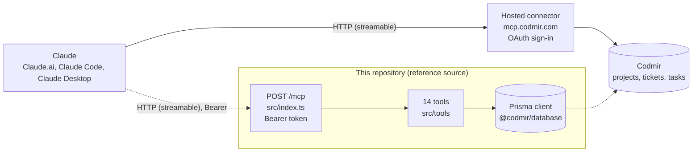

<p align="center">
  <picture>
    <source media="(prefers-color-scheme: dark)" srcset="docs/assets/hero-dark.svg">
    <source media="(prefers-color-scheme: light)" srcset="docs/assets/hero-light.svg">
    
  </picture>
</p>

<p align="center">
  <a href="#status"></a>
  <a href="#how-it-works"></a>
  <a href="#tools"></a>
  <a href="#development"></a>
</p>

<p align="center">
  <a href="#connect-claude-to-codmir"></a>
  <a href="#connect-claude-to-codmir"></a>
  <a href="#connect-claude-to-codmir"></a>
  <a href="#authentication"></a>
  <a href="#this-repository-and-codmirmcp"></a>
  <a href="#development"></a>
</p>

<p align="center">
  <a href="#status"><b>Status</b></a> ·
  <a href="#connect-claude-to-codmir"><b>Connect Claude</b></a> ·
  <a href="#tools"><b>Tools</b></a> ·
  <a href="#how-it-works"><b>How it works</b></a> ·
  <a href="#authentication"><b>Authentication</b></a> ·
  <a href="#troubleshooting"><b>Troubleshooting</b></a> ·
  <a href="#faq"><b>FAQ</b></a> ·
  <a href="https://codmir.com"><b>codmir.com</b></a>
</p>

Work with [Codmir](https://codmir.com) workspaces, projects, tickets and agent tasks from a Claude conversation, over
the [Model Context Protocol](https://modelcontextprotocol.io). This repository holds the source of a standalone Claude
connector server for Codmir (an Express server with 14 tools), a Claude Code marketplace file and a connector manifest.

> [!IMPORTANT]
> **This repository is reference source. It is not how you connect Claude to Codmir today.**
>
> - **Connect now:** add `https://mcp.codmir.com/` as a custom connector in Claude, or run
>   `claude mcp add --transport http codmir https://mcp.codmir.com/` in Claude Code.
>   [Step by step](#connect-claude-to-codmir).
> - **Want a local server instead?** Run `npx -y -p @codmir/mcp codmir-mcp`.
>   [`@codmir/mcp`](https://github.com/codmir-labs/mcp) has more tools than this repository.
> - **What does not work here:** this server cannot be installed or built from this repository alone, and the Claude
>   Code plugin in `.claude-plugin/` loads no tools. [Status](#status) has the evidence for each.

<details>
<summary><b>Contents</b></summary>

- [Status](#status)
- [What it gives Claude](#what-it-gives-claude)
- [Connect Claude to Codmir](#connect-claude-to-codmir)
- [Tools](#tools): [workspace](#workspace), [tickets](#tickets), [agent tasks](#agent-tasks), [saved context](#saved-context), [where this source differs](#where-this-source-differs-from-todays-codmir)
- [How it works](#how-it-works)
- [Authentication](#authentication)
- [Troubleshooting](#troubleshooting)
- [FAQ](#faq)
- [This repository and @codmir/mcp](#this-repository-and-codmirmcp)
- [Repository layout](#repository-layout)
- [Development](#development)
- [License](#license)
- [Links](#links)

</details>

## Status

Checked on 2026-11-23 against this repository at commit `55edd38`.

| Part | Today | Evidence |
| ---- | ----- | -------- |
| The server in `src/` | Readable source that cannot be installed or built from this repository alone. | [`package.json`](package.json) lines 15 to 17 declare `@codmir/auth`, `@codmir/database` and `@codmir/types` as `workspace:*`, and there is no lockfile. `npm install` stops with `EUNSUPPORTEDPROTOCOL` and `pnpm install` with `ERR_PNPM_WORKSPACE_PKG_NOT_FOUND`. |
| The 14 tools | The names are in the current `@codmir/mcp` tool list. The behavior differs from what that list documents. | Every name is in the [`@codmir/mcp` tool reference](https://github.com/codmir-labs/mcp#tool-reference). The differences are listed under [Where this source differs](#where-this-source-differs-from-todays-codmir). |
| Claude Code plugin ([`marketplace.json`](.claude-plugin/marketplace.json)) | The file meets the required fields of Claude Code's marketplace format. The one plugin it lists loads no MCP server, so installing it adds no tools. | Claude Code takes a plugin's MCP servers from `.mcp.json` at the plugin root or from its manifest. The entry at line 12 points at the repository root, which has no `.mcp.json`, and the entry declares no `mcpServers`. |
| Connector manifest ([`.well-known/mcp.json`](.well-known/mcp.json)) | Not usable. | Its URL, `{CODMIR_API_URL}/mcp` (line 5), is a placeholder. Nothing in this repository serves the file, and the Dockerfile does not copy it. |
| Setup steps in earlier versions of this page | Replaced. | The hosted connector signs in with OAuth in the browser, so there is no token to paste; the [`@codmir/mcp` README](https://github.com/codmir-labs/mcp) describes it the same way. The old "Settings > API Tokens" page name could not be confirmed, so it is left out. Anthropic's current guide says Customize > Connectors where this page used to say Settings > Connectors. |

## What it gives Claude

<table>
<tr>
<td width="33%" valign="top">
<br>
<b>Workspace</b><br>
See the organizations you belong to, read a project's overview, and create an organization or a project.
</td>
<td width="33%" valign="top">
<br>
<b>Tickets</b><br>
List what is open, read a ticket with its comments, search, create, update, comment and change a status.
</td>
<td width="33%" valign="top">
<br>
<b>Agent tasks</b><br>
File a task from instructions and read its status back. In this source the task is a ticket; see <a href="#where-this-source-differs-from-todays-codmir">what differs</a>.
</td>
</tr>
<tr>
<td width="33%" valign="top">
<br>
<b>Saved context</b><br>
Save a conversation summary in a project, as a ticket marked done.
</td>
<td width="33%" valign="top">
<br>
<b>Hosted connector</b><br>
Today's way in: add <code>https://mcp.codmir.com/</code> as a custom connector. You sign in with OAuth in the browser, so there is no token to paste.
</td>
<td width="33%" valign="top">
<br>
<b>Reference source</b><br>
A small streamable-HTTP MCP server in TypeScript, built on Express, the MCP SDK and a Prisma client. Read it to see how a connector is put together.
</td>
</tr>
</table>

## Connect Claude to Codmir

Codmir's hosted connector is a remote MCP server. Its address is:

```text
https://mcp.codmir.com/
```

This is the address Codmir's own installer, [`install.sh`](https://codmir.com/install.sh), registers with Claude Code.
Claude reaches it over HTTPS and you sign in with OAuth in your browser. The steps below follow Anthropic's
documentation as of 2026-11-23; menus move, so if yours differ, the linked guide wins.

| Client | How | Anthropic's guide |
| ------ | --- | ----------------- |
| **Claude.ai** | **Customize > Connectors**, then **Add custom connector** | [Custom connectors using remote MCP](https://support.claude.com/en/articles/11175166-get-started-with-custom-connectors-using-remote-mcp) |
| **Claude Desktop** | The same connector, added through your account. A local server goes in `claude_desktop_config.json`. | [Custom connectors](https://support.claude.com/en/articles/11175166-get-started-with-custom-connectors-using-remote-mcp), [local servers](https://modelcontextprotocol.io/docs/develop/connect-local-servers) |
| **Claude Code** | `claude mcp add --transport http codmir https://mcp.codmir.com/`, then `/mcp` to sign in | [Connect Claude Code to tools via MCP](https://code.claude.com/docs/en/mcp) |

<details>
<summary><b>Claude.ai</b></summary>

1. Open **Customize > Connectors**.
2. Click **+ Add**, then **Add custom connector**.
3. Enter a name, for example `Codmir`.
4. Enter the URL `https://mcp.codmir.com/` and click **Continue**.
5. Review the authentication settings Claude detected and click **Continue**. Leave **Request headers** empty: that
   section is for fixed credentials such as API keys, and Codmir's connector signs you in with OAuth instead.
6. Click **Add**. Claude takes you through Codmir's sign-in; if Codmir appears in the list with a **Connect** button
   instead, click it and sign in.
7. In a conversation, open the **+** menu, choose **Connectors** and switch Codmir on.

On a Team or Enterprise plan an Owner adds the connector once, under **Organization settings > Connectors** (**Add**,
hover over **Custom**, then select **Web**). Each member then opens **Customize > Connectors** and clicks **Connect**
next to it. On Enterprise, a custom role that includes "Manage access to Libraries" can add it too. A Free plan can have
one custom connector.

Claude connects to the server from Anthropic's cloud, not from your machine, and only over HTTPS on port 443.

</details>

<details>
<summary><b>Claude Desktop</b></summary>

Anthropic's guide lists Claude Desktop among the clients that support custom connectors, and says that although Claude
Desktop runs on your computer, remote connectors are configured and brokered through your Claude account. So the
Claude.ai steps above are also the Claude Desktop steps.

To run a local server in Claude Desktop instead, add it to `claude_desktop_config.json` and restart the app. Open the
file from **Settings > Developer > Edit Config**. It lives here:

| System | File |
| ------ | ---- |
| macOS | `~/Library/Application Support/Claude/claude_desktop_config.json` |
| Windows | `%APPDATA%\Claude\claude_desktop_config.json` |
| Linux | `~/.config/Claude/claude_desktop_config.json` |

```json
{
  "mcpServers": {
    "codmir": {
      "command": "npx",
      "args": ["-y", "-p", "@codmir/mcp", "codmir-mcp"]
    }
  }
}
```

That is the `@codmir/mcp` server, which signs in with the Codmir CLI. See its
[authentication section](https://github.com/codmir-labs/mcp#authentication).

</details>

<details>
<summary><b>Claude Code</b></summary>

```bash
claude mcp add --transport http codmir https://mcp.codmir.com/
```

Then sign in. In a Claude Code session run `/mcp` and follow the steps in your browser, or run this in your shell:

```bash
claude mcp login codmir
```

By default the server is added for you in the current project only. Add `--scope user` to make it available in all your
projects, or `--scope project` to write it to a `.mcp.json` that your team can commit. Manage it with
`claude mcp list`, `claude mcp get codmir` and `claude mcp remove codmir`.

If you use Claude Code with a claude.ai login, a connector you added in Claude.ai also shows up in `/mcp`. Claude Code
does not load connectors while an API key or a third-party provider is active.

</details>

<details>
<summary><b>The plugin marketplace in this repository</b></summary>

`/plugin marketplace add codmir-labs/mcp-plugin-anthropic` registers this repository as a Claude Code marketplace named
`codmir`, the `name` in [`marketplace.json`](.claude-plugin/marketplace.json), and `codmir-connector@codmir` is the id of
its one plugin.

Claude Code's [plugin manifest reference](https://code.claude.com/docs/en/plugins/manifest-reference) says a plugin's
manifest is optional: without one, Claude Code loads the components it finds in the standard layout. The
[marketplace reference](https://code.claude.com/docs/en/plugins/marketplace-reference) says the marketplace entry is the
manifest in that case. A plugin's MCP servers come from `.mcp.json` at its root or from `mcpServers` in its manifest.
This plugin's source is the repository root, which has no `.mcp.json`, and the marketplace entry declares no server, so
the plugin adds no tools. Use `claude mcp add` above instead. The `add` command is described in
[Create a marketplace](https://code.claude.com/docs/en/plugins/create-marketplace). All of this was checked against the
documentation, not by running Claude Code.

</details>

## Tools

This is what the 14 tools in `src/` do, read from [`src/tools`](src/tools). The hosted connector sends Claude its own
tool list when you connect, and that list can differ from this one. All 14 names are also in the
[`@codmir/mcp` tool reference](https://github.com/codmir-labs/mcp#tool-reference), which documents 83 tools in the
source on its `main` branch.

Eight tools change data. The others only read.

### Workspace

| Tool | What it does | Required | Changes data |
| ---- | ------------ | -------- | ------------ |
| `get_workspace_status` | Lists the organizations you belong to with id, name, slug, plan, your role and project count. Says so when you have none. | none | no |
| `get_project_context` | Returns a project's name, key, type, description, git remote and branch, settings and created date, plus its open, total, member and sprint counts. Open means `OPEN` or `IN_PROGRESS`. | `projectId` | no |
| `create_organization` | Creates an organization on the free plan and makes you its owner. `slug` defaults to the slugified name, and a taken slug is refused. | `name` | yes |
| `create_project` | Creates a project in `organizationId`, or in one of your organizations when it is omitted (the query sets no order, so with several the choice is not defined). `key` defaults to the first five letters or digits of the name and `projectType` to `software`. | `name` | yes |

### Tickets

| Tool | What it does | Required | Changes data |
| ---- | ------------ | -------- | ------------ |
| `list_todo` | Lists a project's actionable tickets: `OPEN`, `IN_PROGRESS` or `TODO` (also what `status: "all"` gives), or only one `status` (`open`, `in_progress` or `review`), optionally one `priority`. Archived tickets are left out. Each item has id, key, title, status, priority, type, assignee and due date. At most 100, default 50, sorted by priority (ascending) and then newest first. | `projectId` | no |
| `get_ticket` | Returns one ticket by id or by key such as `PROJ-42`: its fields, assignee, reporter, labels and its 10 newest comments. | `ticketId` | no |
| `create_ticket` | Creates an `OPEN` ticket. `priority` is `LOW`, `MEDIUM` (default), `HIGH` or `CRITICAL`. `type` is `BUG`, `FEATURE`, `TASK` (default) or `IMPROVEMENT`. The key is the project key plus a per-project number. | `projectId`, `title` | yes |
| `update_ticket` | Changes a ticket's title, description, priority, type, status, assignee (`unassign` clears it) or due date. Takes the ticket id, not its key. | `ticketId` | yes |
| `search_tickets` | Finds tickets in one project whose title or description contains `query`, ignoring case, optionally by `status`. At most 50, default 20, most recently updated first. | `projectId`, `query` | no |
| `add_comment` | Adds a comment to a ticket as you and updates the ticket's activity time. | `ticketId`, `content` | yes |
| `update_todo_status` | Sets a ticket's status to open, in_progress, review, done or closed. | `ticketId`, `status` | yes |

### Agent tasks

| Tool | What it does | Required | Changes data |
| ---- | ------------ | -------- | ------------ |
| `execute_task` | Creates an `OPEN` ticket from `instructions` (its title is the first 200 characters) and returns the ticket id as `executionId`. It starts no agent in this source. With `ticketId`, it also comments on that ticket. | `projectId`, `instructions` | yes |
| `check_task_status` | Reads the ticket whose id is `executionId`: its key, title, status, last update and 5 newest comments. | `executionId` | no |

### Saved context

| Tool | What it does | Required | Changes data |
| ---- | ------------ | -------- | ------------ |
| `store_conversation` | Creates a `DONE` ticket titled `[Context] <title>` that holds your summary and optional content. With `ticketId`, it also comments on that ticket. `tags` is accepted and ignored. | `projectId`, `title`, `summary` | yes |

### Where this source differs from today's Codmir

- **`execute_task` files a ticket and starts nothing.** In `@codmir/mcp`, `execute_task` "queues a code task that a
  Codmir agent executes". Here it inserts a ticket, `check_task_status` reads that ticket back, and nothing in this
  repository runs an agent ([`tasks.ts`](src/tools/tasks.ts)).
- **`store_conversation` writes a ticket, not a documentation page.** In `@codmir/mcp` it "saves a conversation as
  project documentation".
- **`create_ticket` takes `type`.** `@codmir/mcp` takes `ticketType`, keeps `type` as a deprecated alias and also takes
  `assigneeId`. Here `create_ticket` has no assignee argument; only `update_ticket` does.
- **Access is organization membership and nothing more.** `get_workspace_status` reports your role, but no tool checks
  it before acting ([`helpers.ts`](src/tools/helpers.ts)).
- **Ticket tools want the ticket's id.** `update_ticket`, `add_comment` and `update_todo_status` look a ticket up by id
  only; just `get_ticket` also accepts a key such as `PROJ-42`. In `@codmir/mcp` all four accept a key or a number.

## How it works



The solid path is what you use today. The dotted path is what this repository's server does.

A client sends JSON-RPC to `POST /mcp` with a bearer token. The middleware turns the token into a user id. A request
that names no known `mcp-session-id` gets a new Streamable HTTP transport and an MCP server bound to that user; the
session is stored, and later requests that carry its id reuse it. The server declares only the `tools` capability.
`tools/list` returns each tool's name, description and input schema. `tools/call` runs the named handler with the user id
and a Prisma client, and an exception comes back as a result with `isError: true` and the text `Error: <message>`.

| Route | Auth | What it does | Source |
| ----- | ---- | ------------ | ------ |
| `GET /health` | none | JSON with `status`, `service`, `version`, `port`, `activeSessions` and `tools` | [`src/index.ts`](src/index.ts) lines 69 to 78 |
| `POST /mcp` | Bearer | Starts a session, or continues the one named by the `mcp-session-id` header | lines 80 to 107 |
| `GET /mcp` | Bearer | Handles a session's GET request; answers `400` when the session id is missing or unknown | lines 109 to 118 |
| `DELETE /mcp` | none | Ends the session named by the header; answers `204` when there is none | lines 120 to 129 |

A session expires after 30 minutes without activity, and a sweep runs every 5 minutes (lines 15 and 131 to 139). The
server listens on `PORT`, default `3304`.

## Authentication

**The hosted connector** signs you in with OAuth. Claude opens a Codmir screen in your browser where you sign in and
approve the connection. There is no token to create or paste.

**The server in this repository** reads an `Authorization: Bearer <token>` header on `POST /mcp` and `GET /mcp` and
passes the token to `validateBearerToken` from `@codmir/auth/validate`, a package that is not part of this repository
([`src/auth.ts`](src/auth.ts)). A request with no bearer header gets `401` and `{"error": "Missing or invalid Bearer
token"}`. A token that fails validation gets `401` with an `error` and a `code`. After that the tools run as the token's
user, and access to a project is decided by organization membership alone (see [Tools](#tools)).

Where a token for this server comes from is not documented here. Earlier versions of this page sent you to
"Settings > API Tokens"; that page name could not be confirmed, so it is left out.

## Troubleshooting

<details>
<summary><b>I added the marketplace but Claude shows no Codmir tools</b></summary>

That is expected. The plugin in this repository defines no MCP server, so there is nothing for Claude Code to start.
Add the hosted connector with `claude mcp add` instead; see [Connect Claude to Codmir](#connect-claude-to-codmir).

</details>

<details>
<summary><b>Claude cannot connect to the connector</b></summary>

Enter the address exactly as written, `https://mcp.codmir.com/`, including the trailing slash. Claude connects from
Anthropic's cloud, so the address must be public and on HTTPS port 443; a URL with another port, or one on a private
network, cannot connect.

</details>

<details>
<summary><b>Claude Code says the server needs authentication</b></summary>

Run `/mcp` in a session and follow the steps in your browser, or run `claude mcp login codmir` in your shell, which
starts the same OAuth flow without opening the `/mcp` panel.

</details>

<details>
<summary><b>I am on a Team or Enterprise plan and cannot add a custom connector</b></summary>

Only an Owner or Primary Owner can add one on a Team plan. On Enterprise a custom role with "Manage access to Libraries"
can too. Ask one of them to add it under **Organization settings > Connectors**, then click **Connect** under
**Customize > Connectors**.

</details>

<details>
<summary><b><code>npm install</code> or <code>pnpm install</code> fails on <code>workspace:*</code></b></summary>

That is expected here. `@codmir/auth`, `@codmir/database` and `@codmir/types` are packages of Codmir's own workspace and
are not published with this repository. See [Status](#status).

</details>

<details>
<summary><b>Other instructions show <code>https://mcp.codmir.com/mcp</code></b></summary>

Some pages, including the `@codmir/mcp` README, show the address with `/mcp` on the end. Codmir's installer registers
the address without it, `https://mcp.codmir.com/`, so use that one.

</details>

## FAQ

<details>
<summary><b>Is this the official Codmir connector?</b></summary>

No. The connector Codmir hosts is the one at `https://mcp.codmir.com/`, and it signs in with OAuth, which this server
does not implement. This repository is the source of a different, standalone server with 14 tools, kept as reference.
See [Status](#status).

</details>

<details>
<summary><b>Can I run this server myself?</b></summary>

Not from this repository alone. It needs three packages from Codmir's own workspace (`@codmir/auth`,
`@codmir/database` and `@codmir/types`) that are not in this repository. See [Development](#development).

</details>

<details>
<summary><b>What can Claude change?</b></summary>

With the tools in this source, eight of the 14: create an organization, a project and a ticket, update a ticket, add a
comment, set a status, store a conversation and file a task. Anthropic's guide says to review Claude's tool approval
requests carefully and to click "Allow always" only for a server and tool you trust to run unsupervised.

</details>

<details>
<summary><b>Which plans can add a custom connector?</b></summary>

Per Anthropic's guide, Free, Pro, Max, Ultra, Team and Enterprise plans. A Free plan is limited to one. On Team and
Enterprise only an Owner, or an Enterprise custom role, can add one.

</details>

<details>
<summary><b>Is it open source?</b></summary>

This repository has no `LICENSE` file; see [License](#license). The local server, [`@codmir/mcp`](https://github.com/codmir-labs/mcp),
is Apache-2.0.

</details>

## This repository and @codmir/mcp

| | Hosted connector | `@codmir/mcp` | This repository |
| --- | --- | --- | --- |
| Where it runs | Codmir's servers, at `https://mcp.codmir.com/` | Your machine, started by your MCP client | Wherever you run it; building it needs Codmir's workspace packages |
| Transport | Remote, HTTP | stdio | Streamable HTTP |
| Sign-in | OAuth in the browser | `codmir login`, or a token and user id in environment variables | A bearer token checked by a package that is not here |
| Tools | The list the connector sends | 83 on `main`, 33 in 0.2.5, the latest npm release | 14 |
| Source | Not in this repository | npm package, Apache-2.0 | This repository |

The `@codmir/mcp` column follows its [README](https://github.com/codmir-labs/mcp) and the npm registry entry for 0.2.5.
The hosted column follows Codmir's installer and the same README, which calls the hosted endpoint "a separate server
with its own tool list". `@codmir/mcp` also has local tools for your own machine, such as screen vision and desktop
control, which do not call the Codmir API.

## Repository layout

| Path | What it holds |
| ---- | ------------- |
| [`.claude-plugin/marketplace.json`](.claude-plugin/marketplace.json) | The Claude Code marketplace file: marketplace `codmir`, one plugin `codmir-connector` with source `./` |
| [`.well-known/mcp.json`](.well-known/mcp.json) | A connector manifest: one `streamable-http` server at the placeholder `{CODMIR_API_URL}/mcp`, with bearer authentication |
| [`src/index.ts`](src/index.ts) | The Express app: `/health`, `/mcp`, sessions and the wiring to the tools |
| [`src/auth.ts`](src/auth.ts) | The bearer-token middleware around `validateBearerToken` |
| [`src/tools/definitions.ts`](src/tools/definitions.ts) | The 14 tool definitions and their input schemas |
| [`src/tools/index.ts`](src/tools/index.ts) | The map from tool name to handler, and the error wrapper |
| [`src/tools/workspace.ts`](src/tools/workspace.ts) | The four workspace handlers |
| [`src/tools/tickets.ts`](src/tools/tickets.ts) | The seven ticket handlers |
| [`src/tools/tasks.ts`](src/tools/tasks.ts) | `store_conversation`, `execute_task` and `check_task_status` |
| [`src/tools/helpers.ts`](src/tools/helpers.ts) | Result and error formatting, and the organization-membership check |
| [`Dockerfile`](Dockerfile), [`.dockerignore`](.dockerignore) | An image for the server: `node:20-alpine`, port 3304 |
| [`package.json`](package.json), [`tsconfig.json`](tsconfig.json) | Scripts and dependencies; strict TypeScript with NodeNext modules |
| [`docs/assets/`](docs/assets) | This page's hero and icons |

## Development

There is nothing to run from this repository alone. In a Codmir workspace, where the three `workspace:*` packages exist,
the scripts in [`package.json`](package.json) are:

| Script | What it runs |
| ------ | ------------ |
| `dev` | `tsx watch src/index.ts` |
| `build` | `tsc` |
| `start`, `start:prod` | `node dist/index.js` |
| `typecheck` | `tsc --noEmit` |

The server reads `PORT` (default `3304`). Its database connection comes from `createPrismaClient` in
`@codmir/database`, a package that is not in this repository. The [`Dockerfile`](Dockerfile) builds the same server, but
its install steps (`pnpm install --frozen-lockfile`, then `npm ci`) fail without a lockfile, which this repository does
not have; see [Status](#status).

## License

This repository has no `LICENSE` file, and no licence has been added by this page. Earlier versions of this page said
"Proprietary" for Codmir Labs, and `package.json` marks the package `private`. For Apache-2.0 code from Codmir, see
[`@codmir/mcp`](https://github.com/codmir-labs/mcp) and [`@codmir/sdk`](https://github.com/codmir-labs/sdk).

## Links

- [codmir.com](https://codmir.com): the platform
- [Documentation](https://codmir.com/docs/mcp): the Codmir docs page for the local MCP server
- [Support](https://codmir.com/support)
- [`@codmir/mcp`](https://github.com/codmir-labs/mcp): the local stdio server
- [`@codmir/sdk`](https://github.com/codmir-labs/sdk): the SDK for application code
- [Model Context Protocol](https://modelcontextprotocol.io): the specification
- [Get started with custom connectors using remote MCP](https://support.claude.com/en/articles/11175166-get-started-with-custom-connectors-using-remote-mcp): Anthropic's guide for Claude.ai and Claude Desktop
- [Connect Claude Code to tools via MCP](https://code.claude.com/docs/en/mcp): Anthropic's guide for Claude Code
- [Create a marketplace](https://code.claude.com/docs/en/plugins/create-marketplace) and [plugin manifest reference](https://code.claude.com/docs/en/plugins/manifest-reference): Claude Code plugins
- [Connect to local MCP servers](https://modelcontextprotocol.io/docs/develop/connect-local-servers): `claude_desktop_config.json`
